<p align="center">
  
</p>

<p align="center">
  
  
  
  
  
</p>

<p align="center">
  The interactive portfolio of <b>Deepti Nanda</b> — BCA undergraduate and full-stack developer.<br />
  Tap the water, shatter the theme, and win a slingshot game to open my resume.
</p>

<p align="center">
  <a href="#-highlights">Highlights</a> ·
  <a href="#-tech-stack">Tech stack</a> ·
  <a href="#-getting-started">Getting started</a> ·
  <a href="#-deployment">Deployment</a> ·
  <a href="#-connect">Connect</a>
</p>

---

## ✨ Highlights

<table>
  <tr>
    <td width="50%" valign="top">
      <h3>🌊 Water ripple hero</h3>
      Tap the empty hero background and a soft 3D ripple spreads across the drifting gradient, like a stone dropped in water.
    </td>
    <td width="50%" valign="top">
      <h3>💥 Shattering theme switch</h3>
      Toggling light and dark mode cracks the page into glass shards that fall away to reveal the new theme.
    </td>
  </tr>
  <tr>
    <td valign="top">
      <h3>🪐 Skills orbit</h3>
      Skill logos orbit my portrait on two rings. Select one to see which projects use it.
    </td>
    <td valign="top">
      <h3>🎯 Slingshot mini-game</h3>
      Select the portrait to play: three shots, two hits wins a treasure chest that opens my resume.
    </td>
  </tr>
  <tr>
    <td valign="top">
      <h3>📡 Animated project icons</h3>
      A sweeping radar, a beating ECG line and a hand sprinkling spice bring each project card to life.
    </td>
    <td valign="top">
      <h3>📬 Working contact form</h3>
      Messages arrive by email through Resend, with server-side validation and bot protection.
    </td>
  </tr>
  <tr>
    <td valign="top">
      <h3>📄 Resume viewer</h3>
      View the PDF in a modal or download it straight from the navbar.
    </td>
    <td valign="top">
      <h3>🌗 Light and dark themes</h3>
      A calm sage palette in both themes, responsive from small phones to large desktops.
    </td>
  </tr>
</table>

## 🛠️ Tech stack

| Layer | Tools |
| --- | --- |
| Framework | Next.js 16 (App Router, Turbopack), React 19 |
| Language | TypeScript |
| Styling | Tailwind CSS 4, CSS custom properties for theming |
| Animation | Canvas, SVG and CSS animations — no animation libraries |
| Email | Resend |
| Icons | Lucide, Simple Icons |

## 🚀 Getting started

> Requires **Node.js 20.9 or newer**.

```bash
git clone https://github.com/Deepti-Nanda/Portfolio.git
cd Portfolio
npm install
npm run dev
```

Open [http://localhost:3000](http://localhost:3000) and start exploring.

<details>
<summary><b>🔐 Contact form settings</b></summary>
<br />

The contact form sends email through [Resend](https://resend.com). Create a `.env.local` file in the project root:

```bash
RESEND_API_KEY=your_resend_api_key
RESEND_FROM_EMAIL=onboarding@resend.dev
RESEND_TO_EMAIL=you@example.com
```

- `RESEND_FROM_EMAIL` — the sender. Resend's test sender `onboarding@resend.dev` only delivers to the email you signed up with; verify your own domain to send from your own address.
- `RESEND_TO_EMAIL` — where messages are delivered.

`.env.local` is ignored by git, so your API key never reaches GitHub. Everything else works without these settings.

</details>

<details>
<summary><b>📜 Scripts</b></summary>
<br />

| Command | What it does |
| --- | --- |
| `npm run dev` | Start the development server |
| `npm run build` | Create a production build |
| `npm start` | Serve the production build |
| `npm run lint` | Check the code with ESLint |

</details>

<details>
<summary><b>📁 Project structure</b></summary>
<br />

```
app/
  layout.tsx            Fonts, metadata, theme and resume providers
  page.tsx              The single page: all sections and the footer
  globals.css           Theme colours, background effect and shared styles
  api/contact/route.ts  Sends contact form messages through Resend
components/
  hero.tsx              Hero section with the water ripple
  about.tsx             About section and intro video
  projects.tsx          Project cards and their animated icons
  skills.tsx            Skills orbit and slingshot game
  experience.tsx        Experience timeline
  contact.tsx           Contact details and form
  navbar.tsx            Navigation, resume menu and theme toggle
public/
  resume.pdf            The resume shown in the viewer
  game/                 Portrait images for the orbit and game
  projects/             Project images
```

</details>

## ✏️ Make it yours

| To change… | Edit |
| --- | --- |
| Projects | the `projects` list in `components/projects.tsx` |
| Experience | the `experiences` list in `components/experience.tsx` |
| Skills | `SKILLS` in `components/skills.tsx` |
| Resume | replace `public/resume.pdf` |
| Intro video | add `public/intro-video.mp4` — until then a "Coming Soon" thumbnail shows |
| Theme colours | the colour variables at the top of `app/globals.css` |

## ☁️ Deployment

Deploys like any Next.js app — for example on [Vercel](https://vercel.com):

1. Import the repository.
2. Add `RESEND_API_KEY`, `RESEND_FROM_EMAIL` and `RESEND_TO_EMAIL` under **Settings → Environment Variables**.
3. Deploy, then send yourself a test message through the contact form.

## 🤝 Connect

<p align="center">
  <a href="https://x.com/DeeptiNanda"></a>
  <a href="https://linkedin.com/in/deepti-nanda-271b352a3"></a>
  <a href="https://github.com/Deepti-Nanda"></a>
</p>

<p align="center">
  <sub>Made with 💚 by Deepti Nanda</sub>
</p>
